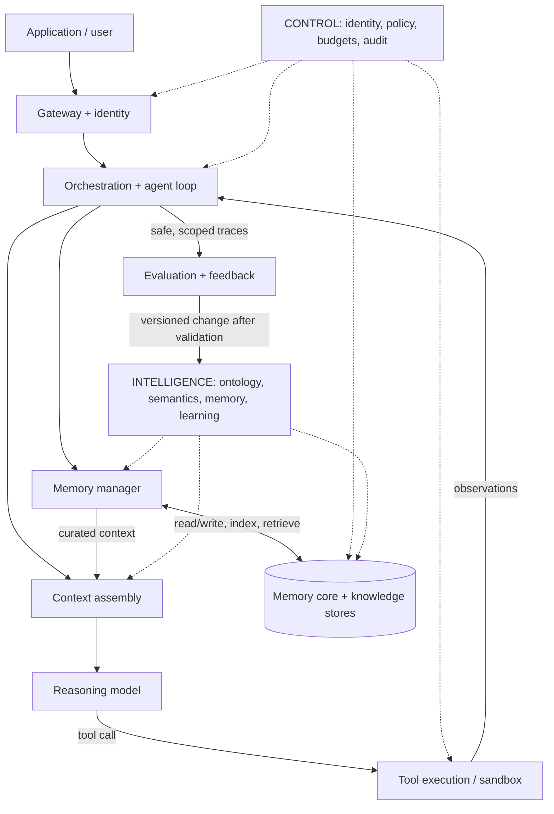

# The Agent Stack — Source Map and Technical Reading Guide (2026)

> **Scope:** Research guide to the *agent stack*, *control plane*, *intelligence plane*, and *model + harness* architecture discussed by Richmond Alake (Oracle) in his AI Engineer NYC talk.  
> **Research date:** 2026-11-01. **Primary video:** [The Intelligence Plane: What your agents know, remember and learn](https://www.youtube.com/watch?v=1_lX0m64-aI) (~25 min). **Event:** [AI Engineer NYC 2026, Oct 13](https://ai.engineer/nyc/2026/schedule).  
> **Evidence labels:** **[T]** supplied talk transcript, **[S]** official slides or speaker material, **[D]** official docs/code, **[P]** academic paper, **[I]** our interpretation. These are *not* all claims of endorsement by Oracle. Links were researched as of the date above; dependency versions and product claims can change.

## Executive answer

An AI agent is not merely an LLM. It is an application with connectivity, an execution loop, reasoning, tools, memory selection/storage, security, and an operational runtime. Alake's proposed **intelligence plane** extends the governed **control plane** with coordinated knowledge, ontology/semantic models, agent memory, and feedback-driven improvements. **A plane is a cross-cutting responsibility, not necessarily an additional independently deployed service.** [T: 01:56–02:34, 07:37–11:43](https://www.youtube.com/watch?v=1_lX0m64-aI&t=116s).

**Most important discovery:** An [Oracle developer slide deck by Richmond Alake](https://oracle-devrel.github.io/oracle-ai-developer-hub/guides/memory_engineering_devweek_sf_2026.pdf) actually includes a nine-row diagram titled **“The Agent Stack”** on **PDF pages 64–65** (counting the first page as page 1). That is the strongest accessible visual primary source for the named layers. **It is an earlier Oracle presentation, not verified as the exact NYC slide deck shown in this video.** The [Oracle AI Developer Hub](https://github.com/oracle-devrel/oracle-ai-developer-hub) hosts this and related tutorials.

## 1. Original-source trail — start here

| Priority | Resource | Why it matters | Evidence |
|---|---|---|---|
| 1 | [Richmond Alake, “The Intelligence Plane” — video](https://www.youtube.com/watch?v=1_lX0m64-aI) | The particular lecture being researched; timestamps below track the supplied transcript. | [T] |
| 1 | [Alake, “Memory Engineering: The Discipline Behind Memory Augmented Agents” — Oracle PDF](https://oracle-devrel.github.io/oracle-ai-developer-hub/guides/memory_engineering_devweek_sf_2026.pdf) | **Pages 64–65:** nine-layer definitions plus an Oracle-specific implementation mapping. Earlier slides also show memory/agent-loop/harness concepts. | [S] |
| 1 | [Oracle AI Developer Hub — repository](https://github.com/oracle-devrel/oracle-ai-developer-hub) | Official collection of downloadable talks, architecture references, notebooks, and runnable workshops. | [D] |
| 1 | [Alake's Memorizz — source](https://github.com/RichmondAlake/memorizz) | Speaker's open-source/experimental agent-memory implementation; includes memory types, retrieval, agents, examples, and continual-learning experiments. **Not production hardened; check its current noncommercial license.** | [D] |
| 2 | [Nacho Martinez, “Building the Brain and Backbone of Enterprise AI Agents” — Oracle PDF](https://oracle-devrel.github.io/oracle-ai-developer-hub/guides/brain_backbone_enterprise_agents_devweek_sf_2026.pdf) | Page 4 shows a **different three-tier grouping**: foundation (gateway, memory, infrastructure); middle (tools, reasoning, orchestration); top (application). Do not mistake for the nine-layer taxonomy. | [S] |
| 2 | [Martinez, “Total Recall: Agent Memory and Harness Engineering”](https://ai.engineer/talks/xs-ob87TTzg-total-recall-agent-memory-harness-engineering) | Related Oracle workshop; model+harness concept, memory substrate, context assembly, skills, and agent loops. | [S] |
| 2 | [Enterprise Data Agent Harness workshop](https://github.com/oracle-devrel/oracle-ai-developer-hub/tree/main/workshops/enterprise-data-agent-harness-workshop) | Worked reference implementation: database, memory, hybrid retrieval, identity-aware access, Python harness, and UI. | [D] |
| 2 | [Oracle Agent Memory research report (Alake et al., 2026)](https://arxiv.org/abs/2607.13157) | Memory-lifecycle design, scope controls, LongMemEval, and benchmarking. Author-affiliated study; treat results as reported rather than independent validation. | [P] |
| 3 | [Oracle AI Agent Memory — engineering write-up](https://blogs.oracle.com/developers/oracle-ai-agent-memory-a-governed-unified-memory-core-for-enterprise-ai-agents) | Four memory types, Python package, storage/security framing. | [D] |
| 3 | [Oracle AI Developer Hub: agent memory notebooks](https://github.com/oracle-devrel/oracle-ai-developer-hub/tree/main/notebooks/agent_memory) | API examples, benchmarks, research/workflow agents, and comparisons. | [D] |

**Exact-video caveat:** The video transcript refers to QR-linked code, an “intelligence plane” reference architecture, and two demos. I could verify related public code/decks but **not the precise QR target, original NYC slide-file download, or exact demo repository** from the transcript alone; do not substitute an unrelated repository and call it the same demo.

## 2. Nine-layer agent stack — faithfully mapped to the Oracle diagram

From Alake's PDF **pp. 64–65**, top to bottom (definitions below paraphrase the *official slide*; implementations are examples, not requirements):

| # | Layer (official label) | Responsibility | What to study/build |
|---:|---|---|---|
| 1 | **Application** | Human/enterprise interface that invokes or consumes agent work | Chat UI, API/webhook, event-driven apps, result streaming, user feedback |
| 2 | **Gateway and Connectivity** | APIs, connectors, messaging and inbound/outbound agent communications | Authentication at ingress, MCP, A2A, API gateway, queue/event bus |
| 3 | **Orchestration** | Plan/route/decompose work; manage plan–act–observe, policy checks, handoffs and state transitions | Bounded loop, workflows, retry/resume, timeouts, HITL, multi-agent |
| 4 | **Reasoning** | Interpret tasks and context, synthesize outputs and propose tool calls | Model selection, prompting, tool-call schema, output validation |
| 5 | **Memory Managers** | Encode, classify, consolidate, summarize, retrieve, rerank, and select memory for working context | Write/read paths, episodic/semantic/procedural memory, retrieval budgets |
| 6 | **Tooling** | Execute actions, scripts, queries, external services, and integrations | Typed tools, sandboxing, idempotence, input constraints, confirmations |
| 7 | **Governance and Reliability** | IAM, policy, guardrails, audit, logging, monitoring, and failure detection | Least privilege, data lineage, threat models, traces, evaluation gates |
| 8 | **Memory Core** | Durable storage and retrieval over structured/unstructured data | Relational/JSON/document/vector/graph; hybrid search; backups; ACLs |
| 9 | **Infrastructure** | Compute/network/containers/runtime/scaling/service reliability | Deployment, isolation, key management, cost/latency telemetry |

**Important classification detail:** In the nine-layer slides, *Governance and Reliability* appears as a named row, but actual control-plane policy and observability should apply **across** all layers. Likewise, a database is not automatically an ontology or semantic layer: those are explicit domain representations and logic built on/alongside storage.

### A runnable conceptual architecture (original synthesis, not a copied slide)

**Simpler alternative:** Martinez's three-tier PDF groups **Layer 0 = gateway + infrastructure + memory**, **Layer 1 = tooling + reasoning + orchestration**, and **Layer 2 = application**. It is a teaching abstraction with different granularity, not a competing nine-row standard. Neither taxonomy is a universally standardized stack or a mandatory purchasing checklist.

## 3. What Alake means by the three planes

| Plane | Main question | Typical capabilities | Failure if absent |
|---|---|---|---|
| **Data / execution plane** | *Where does real work/data movement happen?* | Model inference, API/tool execution, storage, message flow, retrieval. | System cannot act or retrieve. |
| **Control plane** | *Who/what is allowed to act, on which resources, and how is it governed?* | Agent identity, delegated user authority, permissions, policies, budgets, routing, audit. | Unauthorized or untraceable actions. |
| **Intelligence plane** **(speaker's proposal)** | *What does the agent know/remember, what do terms mean, and how does performance improve?* | Knowledge management, memory lifecycle, ontology, semantic layer, context construction, evaluation/traces, iterative model/harness refinement. | Repeated work, inconsistent domain meaning, poor recall and no measured improvement. |

Source: [video 07:37–13:06](https://www.youtube.com/watch?v=1_lX0m64-aI&t=457s). Alake summarizes the design as **agent = model + harness; control adds governance/security; intelligence adds knowledge/memory/learning** [video 11:26–11:43](https://www.youtube.com/watch?v=1_lX0m64-aI&t=686s). This is a **heuristic**, not a formal equation or a proven multiplier law.

### Ontology vs semantic layer vs memory vs retrieval

- **Ontology:** machine-readable representation of entities, classes, relations and constraints (*counterparty* → has jurisdiction → belongs to group). It supports entity resolution and graph/rule-based reasoning; it is **not synonymous with a vector index**. [W3C OWL 2 overview](https://www.w3.org/TR/owl-overview/).
- **Semantic layer:** centrally defined business/data meanings, metrics, joins, dimensions and calculation rules (e.g., precise definition of “concentration”). Prevents conflicting SQL or ungoverned metric derivations. [dbt semantic model docs](https://docs.getdbt.com/docs/build/semantic-models), [dbt Semantic Layer architecture](https://docs.getdbt.com/docs/use-dbt-semantic-layer/sl-architecture).
- **Memory:** durable/working records of interactions, facts, preferences, outcomes, procedures, with lifecycle policies: retain, recall, reuse, refine. [Alake's demo 15:31–16:42](https://www.youtube.com/watch?v=1_lX0m64-aI&t=931s).
- **Retrieval / context engineering:** choose the *right* memory/knowledge subset for the next model call under token, freshness, privacy and evidence constraints. See [LangGraph persistence](https://docs.langchain.com/oss/python/langgraph/persistence) and [MCP architecture](https://modelcontextprotocol.io/docs/learn/architecture).

**Example (our own):** A customer asks “How concentrated is our exposure to counterparties in Germany?” The ontology links legal entities to subsidiaries/countries; the semantic layer defines exposure and denominator; the memory manager finds relevant historical exceptions; the data store supplies current authorized amounts; governance enforces the customer's row visibility; the reasoning model explains the computed result. Those components do **different** jobs.

## 4. Primary technical resources, layer by layer

Each link is selected for a **specific architectural mechanism**, not as proof that a product meets every enterprise requirement.

### 4.1 Application and gateway/connectivity

1. **[D] [Model Context Protocol — Architecture](https://modelcontextprotocol.io/docs/learn/architecture).** Host/client/server concepts; tools, resources, prompts, and transport. Read for **agent-to-tool/context integration**.
2. **[D] [MCP specification](https://modelcontextprotocol.io/specification).** Protocol source of truth; versioned releases. Avoid treating MCP as security or interoperability “magic”; deployment still requires authorization and validation.
3. **[D] [Agent2Agent protocol specification](https://a2a-protocol.org/dev/specification/).** Discovery and collaboration between **independent agents**; useful contrast with MCP (agent↔tool).
4. **[D] [OpenAI Agents SDK — Agents](https://openai.github.io/openai-agents-python/agents/).** Model + instructions + tools, optional handoffs, structured outputs, guardrails.
5. **[D] [Oracle AI Developer Hub](https://github.com/oracle-devrel/oracle-ai-developer-hub).** Integration examples and event-triggered apps.

### 4.2 Orchestration, loop and harness

6. **[P] [Yao et al., *ReAct: Synergizing Reasoning and Acting in Language Models* (ICLR 2023)](https://arxiv.org/abs/2210.03629).** Foundational interleaved reasoning/action/observation pattern; key precursor for this project's curriculum.
7. **[D] [LangGraph — Persistence](https://docs.langchain.com/oss/python/langgraph/persistence).** Thread checkpoints vs cross-thread stores; durable execution and recovery.
8. **[D] [OpenAI Agents SDK — Handoffs](https://openai.github.io/openai-agents-python/handoffs/).** Agent-to-agent transfer, context filtering, and validation at authorization boundaries.
9. **[D] [Oracle Enterprise Data Agent Harness workshop](https://github.com/oracle-devrel/oracle-ai-developer-hub/tree/main/workshops/enterprise-data-agent-harness-workshop).** Build one bounded loop with tool dispatch, checkpointing and real backing data.
10. **[S] [Martinez's *Total Recall* workshop](https://ai.engineer/talks/xs-ob87TTzg-total-recall-agent-memory-harness-engineering).** End-to-end context selection, memory, skills, and failure recovery.

**Distinction:** The **model** proposes/decides; the **harness** owns tool invocation, state transitions, privileges, retries, and stop criteria. “Agent = model + harness” is useful shorthand; it does not imply every agent needs multiple LLMs or a graph orchestrator.

### 4.3 Reasoning, routing and decision models

11. **[D] [OpenAI Agents SDK — Agents](https://openai.github.io/openai-agents-python/agents/).** Concrete orchestration/model boundary.
12. **[D] [TypeSafe AI — Introducing System One / Jev (Sep 15, 2026)](https://typesafe.ai/blog/introducing-system-one-models-and-jev).** Vendor-defined *typed decision model*: state + bounded questions → probabilities/choices. Independent reliability must be evaluated.
13. **[D] [Cloudflare — Introducing Clef (Oct 1, 2026)](https://blog.cloudflare.com/clef-decision-models/).** Open-weight decision-model approach for bounded routing/classification. The vendor says it scores valid schema choices directly.
14. **[D] [Cloudflare Clef model docs](https://developers.cloudflare.com/workers-ai/models/clef/).** API/cost/context specifications; version-specific.
15. **[D] [Ollama — Jev-style decision models (Sep 29, 2026)](https://registry.ollama.com/blog/ollama-now-supports-jev-style-decision-models).** Local typed-decision API; lets you prototype memory routing without a text-generating LLM per decision.
16. **[P] [*Typed Decision Models: An Early Evidence Audit and Evaluation Checklist* (2026)](https://arxiv.org/abs/2609.32160).** Early evidence audit; typed output guarantees valid form, **not correct decisions or calibrated certainty**.

**Talk relevance:** At [13:14–13:58](https://www.youtube.com/watch?v=1_lX0m64-aI&t=794s) the speaker argues routing/other retrieval decisions can be made by specialized models. At [20:58–23:15](https://www.youtube.com/watch?v=1_lX0m64-aI&t=1258s) he demonstrates fine-tuning a memory router. **Decision models are optional**; deterministic rules are usually preferable for hard authorization decisions.

### 4.4 Memory managers, memory core, retrieval

17. **[P] [Park et al., *Generative Agents* (2023)](https://arxiv.org/abs/2304.03442).** Experience stream, reflection, retrieval and planning; historical precursor.
18. **[P] [Shinn et al., *Reflexion* (2023)](https://arxiv.org/abs/2303.11366).** Episodic verbal feedback reused across attempts **without changing model weights**.
19. **[P] [Packer et al., *MemGPT* (2023)](https://arxiv.org/abs/2310.08560).** Virtual context management inspired by memory hierarchies; tiers are a useful analogy but not literal human cognition.
20. **[P] [Alake et al., *Oracle Agent Memory as an Enterprise Memory Substrate* (2026)](https://arxiv.org/abs/2607.13157).** Memory extraction, scope, consolidation, retrieval, and evaluation; vendor-affiliated.
21. **[D] [Memorizz — source, examples, continual learning](https://github.com/RichmondAlake/memorizz).** Speaker's own experimental implementation; distinguish its memory APIs from Oracle's separate product.
22. **[D] [Oracle Agent Memory package guide and notebooks](https://github.com/oracle-devrel/oracle-ai-developer-hub/tree/main/notebooks/agent_memory).** Threads, facts, memory extraction, scoped storage, hybrid retrieval.
23. **[D] [LangGraph — Persistence](https://docs.langchain.com/oss/python/langgraph/persistence).** Contrast **thread checkpointer** (short-term) vs **cross-thread store** (long-term).
24. **[D] [OpenAI Agents SDK — Sessions](https://openai.github.io/openai-agents-python/sessions/).** A different session-history abstraction: **conversation state is not automatically curated long-term memory**.
25. **[D] [Oracle memory engineering slide PDF](https://oracle-devrel.github.io/oracle-ai-developer-hub/guides/memory_engineering_devweek_sf_2026.pdf).** Context cards, application modes, memory manager and agent loop; the same deck contains the original stack diagram.

**Recommended memory lifecycle:** Observe → determine if worth remembering → classify/scope → deduplicate/redact → store with provenance, TTL and policy → retrieve with lexical + semantic signals → rerank/context-pack → check usefulness/freshness → correct/delete/supersede. This workflow is **our synthesis** of the cited sources, not a verbatim vendor API.

### 4.5 Tooling and action safety

26. **[D] [MCP architecture / specification](https://modelcontextprotocol.io/docs/learn/architecture).** How tool descriptions, discovery and calls enter the system.
27. **[D] [OpenAI Agents SDK — Guardrails](https://openai.github.io/openai-agents-python/guardrails/).** Boundary checks; read carefully because an SDK's guardrail hooks **do not cover every side-effect path equally**.
28. **[D] [OWASP Top 10 for Agentic Applications](https://genai.owasp.org/2025/12/09/owasp-top-10-for-agentic-applications-the-benchmark-for-agentic-security-in-the-age-of-autonomous-ai/).** Tool misuse, privilege abuse, memory poisoning, unsafe inter-agent communication; useful threat-model checklist.
29. **[D] [OpenAI Agents SDK — Handoffs](https://openai.github.io/openai-agents-python/handoffs/).** Check delegated authority **before** acting; don't mistake a handoff for a trusted action.

### 4.6 Governance and reliability / control plane

30. **[D] [OWASP Agentic Security Initiative](https://genai.owasp.org/initiatives/agentic-security-initiative/).** Agentic Top 10 (2026) and the Agent Control Standard.
31. **[D] [NIST AI RMF + resources](https://www.nist.gov/itl/ai-risk-management-framework/ai-risk-management-framework-resources).** Governance, measurement and operational risks; framework, not a runtime.
32. **[D] [NIST AI 600-1: Generative AI Profile](https://www.nist.gov/publications/artificial-intelligence-risk-management-framework-generative-artificial-intelligence).** Risk categories and safeguards for genAI.
33. **[D] [Oracle Deep Data Security Guide (26ai)](https://docs.oracle.com/en/database/oracle/oracle-database/26/ddscg/index.html).** Oracle-specific row/column/cell authorization approaches; related to user/agent delegated identity in the talk.
34. **[D] [OpenAI Agents SDK — Tracing](https://openai.github.io/openai-agents-python/tracing/).** Inspect model generations, tool calls, handoffs and guardrails as spans; check retention and sensitive-data settings.
35. **[D] [OpenTelemetry — Generative AI conventions](https://opentelemetry.io/docs/specs/semconv/gen-ai/).** Cross-provider trace vocabulary for cost, latency, model and agent spans.

**Threat-model insight:** Writing memories is a privileged side effect: malicious retrieved text may try to become a durable instruction. Validate provenance/authority, enforce scoped reads and writes, redact secrets, maintain deletion, and test memory poisoning. Merely placing “guardrails” in a prompt is not access control.

### 4.7 Infrastructure and operations

36. **[D] [Oracle Enterprise Data Agent Harness](https://github.com/oracle-devrel/oracle-ai-developer-hub/tree/main/workshops/enterprise-data-agent-harness-workshop).** Deployable service + application backing components.
37. **[D] [OpenTelemetry GenAI conventions](https://opentelemetry.io/docs/specs/semconv/gen-ai/).** Trace/token/cost/latency instrumentation.
38. **[D] [OpenAI Agents SDK — Testing](https://openai.github.io/openai-agents-python/testing/).** Controlled tests for tool dispatch, handoffs, retry, session, and guardrail code; combine with live model evals.
39. **[D] [Oracle AI Developer Hub](https://github.com/oracle-devrel/oracle-ai-developer-hub).** Reference apps and notebooks for enterprise infrastructure, connectors and observability.

### 4.8 Ontology and semantic layer — the center of the talk's first demo

40. **[D] [W3C OWL 2 Document Overview](https://www.w3.org/TR/owl-overview/).** Classes/relations/formal semantics; ontology grounding.
41. **[D] [dbt Semantic Models](https://docs.getdbt.com/docs/build/semantic-models).** Entity-driven metric graph / domain vocabulary.
42. **[D] [dbt Semantic Layer architecture](https://docs.getdbt.com/docs/use-dbt-semantic-layer/sl-architecture).** Governed metric definitions and correct query generation.
43. **[D] [Oracle Developer Hub: finance-ai-agent-demo](https://github.com/oracle-devrel/oracle-ai-developer-hub/tree/main/apps/finance-ai-agent-demo).** Related example of multi-model finance data; **not verified as the NYC governed-vs-naive demo**.

**Design caution:** Ontology, semantic layer, and relational schema are not synonyms. A semantic layer can be just versioned metric/relationship definitions; a formal ontology with OWL/RDF is optional and justified only where entity relationships/inference matter.

### 4.9 Continual learning / closed-loop intelligence

44. **[P] [Reflexion](https://arxiv.org/abs/2303.11366).** Improvement by feedback/memory (non-parametric), not fine-tuning.
45. **[P] [Oracle Agent Memory paper](https://arxiv.org/abs/2607.13157).** Lifecycle, memory-specific evaluation, and vendor-reported benchmarks.
46. **[D] [Memorizz continual-learning examples](https://github.com/RichmondAlake/memorizz/tree/main/examples/continual_learning).** Speaker-linked experimental implementation; inspect pinned revision before running.
47. **[D] [Cloudflare Clef decision-model release](https://blog.cloudflare.com/clef-decision-models/).** Example of a small, specialized trainable decision component in an agent.
48. **[D] [TypeSafe Jev release](https://typesafe.ai/blog/introducing-system-one-models-and-jev).** Compare operational tradeoffs of typed decisions vs text generation.
49. **[D] [OpenAI Agents SDK — Tracing](https://openai.github.io/openai-agents-python/tracing/).** Collect evidence for a feedback loop, but **traces by themselves are not learning**.

**Three distinct update targets:** (a) *token/context space*: retrieved memories, rules, dynamic prompts; (b) *harness/procedural space*: tested skills, routing, code, tool descriptions; (c) *weight/representation space*: fine-tune classifiers, embedders, rerankers. Only the third necessarily updates model parameters. The transcript additionally mentions *latent-space* adaptation; do not equate prompt caching with weight training. [Video 24:42–25:13](https://www.youtube.com/watch?v=1_lX0m64-aI&t=1482s).

## 5. Lecture timeline — exact parts to revisit

| Time | Talk section | Research anchors |
|---|---|---|
| [00:49](https://www.youtube.com/watch?v=1_lX0m64-aI&t=49s) | Memory definition and four Rs | pp. 64–65 stack slides; Alake's Memorizz; Oracle memory paper |
| [01:56](https://www.youtube.com/watch?v=1_lX0m64-aI&t=116s) | Control plane | IAM/policy/audit, OWASP, NIST, Deep Data Security |
| [02:41](https://www.youtube.com/watch?v=1_lX0m64-aI&t=161s) | Software factory | Distinguish *agent harness* from *reliable software-production workflow* |
| [03:50](https://www.youtube.com/watch?v=1_lX0m64-aI&t=230s) | Intelligence plane introduced | Ontology, semantic layer, memory, evaluations |
| [04:36](https://www.youtube.com/watch?v=1_lX0m64-aI&t=276s) | “AF is Midway” story | Illustrative analogy: access to data ≠ evidence synthesis; not proof for agent architecture |
| [07:37](https://www.youtube.com/watch?v=1_lX0m64-aI&t=457s) | Cross-cutting architecture | Nine-layer Oracle slide + control/intelligence overlay |
| [11:26](https://www.youtube.com/watch?v=1_lX0m64-aI&t=686s) | Model + harness | LangGraph, Agents SDK, Total Recall |
| [12:03](https://www.youtube.com/watch?v=1_lX0m64-aI&t=723s) | Reference architecture | Runtime ↔ memory manager/store ↔ continual learning |
| [13:14](https://www.youtube.com/watch?v=1_lX0m64-aI&t=794s) | Decision models | Jev, Clef, locally run models |
| [14:07](https://www.youtube.com/watch?v=1_lX0m64-aI&t=847s) | Governed vs naive analyst | Ontology, semantics, controls, token/accuracy claims |
| [17:05](https://www.youtube.com/watch?v=1_lX0m64-aI&t=1025s) | Team recommendations | Treat memory as data; define entities, enforce entitlement, record traces |
| [18:08](https://www.youtube.com/watch?v=1_lX0m64-aI&t=1088s) | Oracle package/security/private inference | OAMP docs, Deep Data Security docs |
| [20:58](https://www.youtube.com/watch?v=1_lX0m64-aI&t=1258s) | Memory-routing demo | Memorizz, small decision model, retraining |
| [24:42](https://www.youtube.com/watch?v=1_lX0m64-aI&t=1482s) | Continual learning | Capture→evaluate→revise/retrain; no automatic quality improvement |

## 6. What is demonstrated vs asserted vs unverified?

**Supported by the supplied transcript:** Speaker compares governed and naive finance agents and **reports** approximately 32,000 vs 200,000 tokens and approximately 99% accuracy for the governed system [14:36–15:09](https://www.youtube.com/watch?v=1_lX0m64-aI&t=876s). He also shows examples of different answers with ontology/semantic layers [15:31–16:42](https://www.youtube.com/watch?v=1_lX0m64-aI&t=931s).

**What we *cannot* establish from the video transcript:** benchmark dataset/sample size, exact denominator of “accuracy,” model/prompt parity, measurement protocol, repetitions/CI, latency distribution, whether token savings were entirely attributable to the intelligence plane, or if there were confounders (caches, reduced context, domain constraints). **Do not report these demo values as independently validated performance.** The separate Oracle memory paper's LongMemEval numbers are from a different evaluation; don't combine them with the video.

**Claims needing qualification:** “Intelligence plane” is a speaker-proposed useful grouping, not a universally agreed standard; access to the same data does not establish equal inference quality; “memory” may improve an agent without weights changing; typed decision outputs can be confidently wrong; private inference is not automatically secure.

**Evidence quality hierarchy:** publicly linked original deck + docs → reproducible source/test fixtures → peer-reviewed or transparent independent evaluation → vendor benchmark → conference demo → speaker assertion. A QR code or slide screenshot is not an experimental protocol.

## 7. Minimal reference architecture to build (vendor-neutral)

Start with **one agent**, not a product purchase list:

1. **Entry & auth:** simple UI/API, caller ID, allowed scopes.
2. **Bounded harness:** plan–act–observe; max turns/cost/time; safe termination; checkpoints.
3. **Tools:** schema-validated; read and write separated; destructive operations gated; tool outputs treated as untrusted.
4. **Memory core:** durable thread log and a cross-thread store with namespaces, provenance, created/updated timestamps and deletion.
5. **Memory manager:** explicit capture policy, extraction, deduplication, hybrid retrieval and context packing; no unapproved cross-user leakage.
6. **Domain meaning:** glossary/entity relations, governed definitions of metrics and source-of-truth records; add an ontology only when useful.
7. **Observability & eval:** trace one run end-to-end; measure task success, cost, latency, memory recall, unauthorized retrieval/tool attempts and error recovery.
8. **Feedback loop:** collect approved traces → curate examples → change one variable (retrieval/prompt/routing/code/model) → rerun regression suite → version/roll back. **No blind online fine-tuning from raw traces.**

**Minimal experimental ablation** to test the intelligence-plane claim fairly: evaluate *same tasks, same model, same tool permissions and same data*, with (A) plain retrieval, (B) retrieval + semantic definitions, (C) B + entity relationships, (D) C + memory, (E) D + feedback-trained router. Measure success/validity, groundedness, prohibited access, input/output tokens, end-to-end latency, and variance across repeated runs. Report confidence intervals and category-wise failures. Avoid leakage between training/eval turns.

## 8. Reading order for the AI Native project

| Stage | Read / build | Why now |
|---|---|---|
| **1: Original grounding** | The [two Oracle PDF diagrams](https://oracle-devrel.github.io/oracle-ai-developer-hub/guides/memory_engineering_devweek_sf_2026.pdf), video at 07:37, and Martinez's [3-layer diagram](https://oracle-devrel.github.io/oracle-ai-developer-hub/guides/brain_backbone_enterprise_agents_devweek_sf_2026.pdf) | Avoid mixing layers and planes. |
| **2: Model to agent** | [ReAct](https://arxiv.org/abs/2210.03629) → [OpenAI Agents SDK](https://openai.github.io/openai-agents-python/agents/) → [LangGraph checkpoints](https://docs.langchain.com/oss/python/langgraph/persistence) | Understand the loop/harness before adding memory. |
| **3: Tools & trust** | [MCP](https://modelcontextprotocol.io/docs/learn/architecture), [A2A](https://a2a-protocol.org/dev/specification/), [OWASP Agentic](https://genai.owasp.org/initiatives/agentic-security-initiative/) | Separate the authority to act from the ability to reason. |
| **4: Memory** | [Generative Agents](https://arxiv.org/abs/2304.03442), [Reflexion](https://arxiv.org/abs/2303.11366), [MemGPT](https://arxiv.org/abs/2310.08560), [Memorizz](https://github.com/RichmondAlake/memorizz) | Compare memory types, lifecycles, and evidence. |
| **5: Domain meaning** | [OWL overview](https://www.w3.org/TR/owl-overview/) + [dbt semantic layer](https://docs.getdbt.com/docs/use-dbt-semantic-layer/sl-architecture) | Understand why raw RAG cannot reliably define enterprise terms. |
| **6: Measured intelligence** | [Oracle OAMP paper](https://arxiv.org/abs/2607.13157), [Jev](https://typesafe.ai/blog/introducing-system-one-models-and-jev), [Clef](https://blog.cloudflare.com/clef-decision-models/), [tracing](https://openai.github.io/openai-agents-python/tracing/) | Test retrieval/decision/cost claims rather than assume them. |
| **7: Full implementation** | [Oracle enterprise harness workshop](https://github.com/oracle-devrel/oracle-ai-developer-hub/tree/main/workshops/enterprise-data-agent-harness-workshop) or recreate its interfaces with independent tools | See the integrated system, then design your own vendor-neutral version. |

## 9. Suggested visuals/decks for anatomy-of-AI (not yet implemented)

- **Stack:** Nine-layer vertical stack (source: Oracle PDF p.64) with hoverable responsibilities and example implementations; show the 3-tier version as a **separate alternative**.
- **Planes:** Cross-cutting overlays—execution/data, control/governance, intelligence/learning—without suggesting there are nine isolated servers.
- **Single-query walkthrough:** Same finance question moving from UI to identity → ontology and metric definitions → retrieval → authorized query → model answer → trace.
- **Memory lifecycle:** Chat turn → extract candidate → classify + permission check → deduplicate → scoped store → retrieve + rerank → context → correct/supersede.
- **Ablation:** Governed vs naive *only with verified numbers*; mark original speaker figures “self-reported, unspecified eval”.
- **Outer feedback loop:** Traces → curation → evaluation → versioned memory/harness/model change → deploy/rollback; distinguish in-context vs weight changes.

## 10. Open research questions / missing assets

- [ ] Locate the **exact NYC talk slides** or speaker-provided slide-sharing link (not merely the older Oracle deck).
- [ ] Resolve the **actual QR-code demo/code URL** from a video frame or a speaker release; never guess from adjacent repositories.
- [ ] Locate a runnable **governed vs naive analyst** comparison with prompt/model/data parity and an evaluation script.
- [ ] Identify the memory-router model and training split in the speaker's demo; verify whether its dataset is public.
- [ ] Find independent agent stack or intelligence-plane evaluations that isolate ontology/semantic layer/memory impact.
- [ ] Decide how to version domain ontology and metric semantics; establish an ACL policy for retrieval *before* memory extraction.

---

### Source integrity note

The **original video** is grounded in the transcript provided by the user. The **nine official layer labels** and their responsibilities come from the public Oracle PDF (pp. 64–65), which is a related but separately dated presentation. All suggested system diagrams, cross-plane mappings, learning ablations and implementation sequences above are **editorial synthesis**, not copied architecture from the NYC slides. Vendor documentation establishes what a system offers; it does not by itself prove that the conference demonstration's accuracy/cost numbers generalize.
